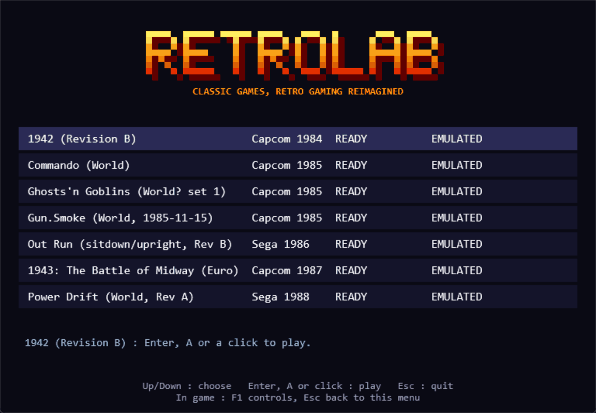

# RetroLab

*Classic Games, Retro Gaming Reimagined*

<details>
<summary><b>🇬🇧 English</b></summary>

<p align="center"></p>
<p align="center"><a href="https://vincentgsell.github.io/RetroLab/en.html"><b>RetroLab</b>: the project site</a></p>

Project goals:
- Rewrite and *understand* the emulation of the arcade cabinets and home computers of the era.
- Write it in modern Object Pascal, as a faithful abstraction of the game boards and their circuits.
- Rebuild the CPUs and boards of the 1980s chip by chip, as code that both humans and AIs can read and reuse.
- Play my favourite retro games easily, out of the box, with modern gamepads and everything set up properly :)
- Maybe write tribute games to the titles that built the world of video games?

## Play

- Emulated arcade games available: 1942, Commando, Gun.Smoke, 1943 and Ghosts'n Goblins by Capcom, OutRun and Power Drift by Sega.
- You play with an Xbox gamepad or any XInput gamepad, which can be plugged in while a game is running. The keyboard works too.
- With two players, 1943 is played at the same time, in co-op, with one gamepad each. 1942, Commando, Gun.Smoke and Ghosts'n Goblins are played in turns, as on the cabinet.
- In OutRun and Power Drift, left and right turn the wheel, button 1 accelerates, button 2 brakes and button 3 shifts gear. The gamepad vibrates like the cabinet's wheel (the V key turns vibrations off).
- The F1 key shows the controls and lets you change them.

## The project

- This is a work in progress.
- Today, an arcade cabinet emulated in Delphi plays these seven games.
- This cabinet is deterministic. With the same inputs it replays exactly the same game, which is how every code change gets checked.
- What comes next is described in the [roadmap](PORTING_PLAN.en.md).

## ROMs: you provide them

This repository provides no ROM and must not contain any. Use your own ROM sets in MAME format, placed in a `roms/` folder at the root of the repository:

| Game | File | MAME set |
|---|---|---|
| 1942 | `roms/1942.zip` | 1942 (Revision B) |
| Commando | `roms/commando.zip` | Commando (World) |
| Gun.Smoke | `roms/gunsmoke.zip` | Gun.Smoke (World, 1985-11-15) |
| 1943 | `roms/1943.zip` | 1943: The Battle of Midway (Euro) |
| Ghosts'n Goblins | `roms/gng.zip` | Ghosts'n Goblins (World? set 1) |
| OutRun | `roms/outrun.zip` | Out Run (sitdown/upright, Rev B) |
| Power Drift | `roms/pdrift.zip` | Power Drift (World, Rev A) |

Every file is checked by its CRC32. If a file is missing or does not match, the cabinet says which one.

## Build and run

1. Open `samples/Cabinet/Cabinet.dpr` in Delphi and compile for Win64. Every unit is listed in the `.dpr`, so there is nothing else to configure. The project is developed with Delphi 13.
2. When it starts, `Cabinet.exe` shows the game menu and tells, for each game, whether its ROM is there. To start a game directly: `Cabinet.exe --set commando`.

## Cabinet settings (DIP switches)

Arcade boards have DIP switches for difficulty, number of lives, coinage or cabinet type. Cabinet sets them from the command line, as a hexadecimal value per bank:

- `--dip0 XX` sets the first bank, `--dip1 XX` the second one. On the Sega boards, bank 0 holds the game settings and bank 1 the coinage.
- `--service` starts the board in its test mode.

For OutRun and Power Drift, the difficulty sits in the top two bits of bank 0:

| Game | Default | Easy | Hard | Hardest |
|---|---|---|---|---|
| Power Drift (`--set pdrift`) | `EA` | `--dip0 AA` | `--dip0 6A` | `--dip0 2A` |
| OutRun, traffic (`--set outrun`) | `F9` | `--dip0 B9` | `--dip0 79` | `--dip0 39` |

In OutRun, bits 4 and 5 set the time allowed per stage. `--dip0 A9` gives both an easy time limit and light traffic.

For Power Drift, `--dip0 EB` turns the cabinet into the moving (deluxe) model. The game then drives the seat, and its roll comes through the gamepad vibrations, on the left or the right.

## How the code is organised

The code is organised like the real machine. There is a cabinet, boards that plug into it, chips soldered on those boards, and cartridges that hold the games.

```
samples/Cabinet   the cabinet: window, sound, controls
src/cabinet       monitor, speaker, control panel, gamepads
src/core          the edge connector every board plugs into, ROM loading
src/boards        one unit per hardware board, named after its PCB number
src/chips         processors and sound chips: reusable by any board
src/romsets       the cartridges: which ROM files, for which board
```

### The boards

Each board is a unit (`src/boards/Arcade.Board.<name>.pas`). Its video is in the `.Video` unit, and its graphics decoding, when it has one, in the `.Gfx` unit.

| Board | Hardware | Chips on it | Game (cartridge unit) |
|---|---|---|---|
| `Capcom84100` | Capcom PCB 84100, 1984 | 2 × Z80, 2 × AY-3-8910 | 1942 (`Arcade.RomSet.Capcom1942`) |
| `Capcom85605` | Capcom PCB 85605, 1985 | 2 × Z80 (encrypted opcodes), 2 × YM2203 | Commando (`Arcade.RomSet.Commando`) |
| `Capcom85113` | Capcom PCB 85113, 1985 | 2 × Z80, 2 × YM2203 | Gun.Smoke (`Arcade.RomSet.GunSmoke`) |
| `Capcom85606` | Capcom PCB 85606, 1985 | MC6809, Z80, 2 × YM2203 | Ghosts'n Goblins (`Arcade.RomSet.GhostsNGoblins`) |
| `CapcomBM` | Capcom "BM" board, 1987 | 2 × Z80, Intel 8751, 2 × YM2203 | 1943 (`Arcade.RomSet.Midway1943`) |
| `Sega1715376` | Sega 171-5376 (Out Run), 1986 | 2 × MC68000, Z80, YM2151, Sega PCM | OutRun (`Arcade.RomSet.OutRun`) |
| `Sega1715609` | Sega Y Board 171-5609, 1988 | 3 × MC68000, Z80, YM2151, Sega PCM, 3 × 315-5248 / 315-5249, 315-5296 | Power Drift (`Arcade.RomSet.PowerDrift`) |

### The chips

Each chip is a unit in `src/chips` that depends on no other unit. It only knows its own pins, that is memory, interrupts and sound output.

| Chip | Unit | Role | Boards |
|---|---|---|---|
| Zilog Z80 | `Arcade.Chip.Z80` (+ `.Disasm`) | 8-bit CPU, main or sound | all seven |
| Motorola MC6809 | `Arcade.Chip.M6809` | 8-bit CPU | Capcom85606 |
| Motorola MC68000 | `Arcade.Chip.M68000` | 16/32-bit CPU | Sega1715376, Sega1715609 |
| Intel 8751 (MCS-51) | `Arcade.Chip.MCS51` | protection microcontroller | CapcomBM |
| General Instrument AY-3-8910 | `Arcade.Chip.AY8910` | 3-voice square wave sound | Capcom84100, and inside the YM2203 |
| Yamaha YM2203 | `Arcade.Chip.YM2203` | FM sound, 3 voices | Capcom85605, 85113, 85606, BM |
| Yamaha YM2151 | `Arcade.Chip.YM2151` | FM sound, 8 voices, stereo | Sega1715376, Sega1715609 |
| Sega 315-5218 | `Arcade.Chip.SegaPCM` | 16 sampled voices | Sega1715376, Sega1715609 |
| Sega 315-5248 / 315-5249 | `Arcade.Chip.SegaMath` | hardware multiplier and divider | Sega1715609 |
| Sega 315-5296 | `Arcade.Chip.Sega315_5296` | 8-port I/O controller | Sega1715609 |

- A board is named after its hardware (for example `Capcom84100`). If a file is named after a game, you are reading a part that belongs to that game's own implementation.
- A game only exists as a cartridge, in `src/romsets`.
- To add a game on hardware that is already emulated, you only write its cartridge unit.
- To add new hardware, you write a board unit that reuses the existing chips.

The programs are in French or English (`--lang fr`, `--lang en`). A translation is one JSON file in `lang/`.

## License

MPL-2.0 ([LICENSE](LICENSE)). Third-party code and trademarks: [NOTICE.md](NOTICE.md). The project uses a few units of the GS-Core library, included in `third_party/gs-core`.

</details>

<details open>
<summary><b>🇫🇷 Français</b></summary>

<p align="center"></p>
<p align="center"><a href="https://vincentgsell.github.io/RetroLab/"><b>RetroLab</b> : le site du projet</a></p>

Buts du projet :
- Réécrire et *comprendre* l'émulation des bornes d'arcade et des ordinateurs de l'époque.
- L'écrire en Pascal objet moderne, sous la forme d'une abstraction fidèle des cartes électroniques des jeux et de leurs circuits.
- Reconstruire puce par puce les processeurs et les cartes des années 80, avec un code que les humains comme les IA peuvent lire et réutiliser.
- Jouer facilement à mes jeux rétro préférés, prêts à l'emploi, avec des manettes modernes et tout bien configuré :)
- Peut-être écrire des jeux hommages à ces titres qui ont construit le monde du jeu vidéo ?

## Jouer

- Jeux d'arcade émulés disponibles : 1942, Commando, Gun.Smoke, 1943 et Ghosts'n Goblins de Capcom, OutRun et Power Drift de Sega.
- On joue avec une manette Xbox ou n'importe quelle manette XInput, qu'on peut brancher en cours de partie. Le clavier fonctionne aussi.
- À deux joueurs, 1943 se joue en même temps, en coopération, avec une manette chacun. 1942, Commando, Gun.Smoke et Ghosts'n Goblins se jouent chacun son tour, comme sur la borne.
- Dans OutRun et Power Drift, gauche et droite font tourner le volant, le bouton 1 accélère, le bouton 2 freine et le bouton 3 change de vitesse. La manette vibre comme le volant de la borne (la touche V coupe les vibrations).
- La touche F1 affiche les commandes et permet de les modifier.

## Le projet

- C'est un travail en cours.
- Aujourd'hui, une borne d'arcade émulée en Delphi fait tourner ces sept jeux.
- Cette borne est déterministe. Avec les mêmes commandes, elle rejoue exactement la même partie, ce qui permet de vérifier chaque modification du code.
- La suite du projet est décrite dans la [feuille de route](PORTING_PLAN.md).

## Les ROMs : à fournir vous-même

Ce dépôt ne fournit aucune ROM et ne doit pas en contenir. Utilisez vos propres sets de ROM au format MAME, à placer dans un dossier `roms/` à la racine du dépôt :

| Jeu | Fichier | Set MAME |
|---|---|---|
| 1942 | `roms/1942.zip` | 1942 (Revision B) |
| Commando | `roms/commando.zip` | Commando (World) |
| Gun.Smoke | `roms/gunsmoke.zip` | Gun.Smoke (World, 1985-11-15) |
| 1943 | `roms/1943.zip` | 1943: The Battle of Midway (Euro) |
| Ghosts'n Goblins | `roms/gng.zip` | Ghosts'n Goblins (World? set 1) |
| OutRun | `roms/outrun.zip` | Out Run (sitdown/upright, Rev B) |
| Power Drift | `roms/pdrift.zip` | Power Drift (World, Rev A) |

Chaque fichier est contrôlé par son CRC32. Si un fichier manque ou ne correspond pas, la borne indique lequel.

## Compiler et lancer

1. Ouvrez `samples/Cabinet/Cabinet.dpr` dans Delphi et compilez en Win64. Toutes les unités sont déclarées dans le `.dpr`, il n'y a donc rien d'autre à configurer. Le projet est développé avec Delphi 13.
2. Au lancement, `Cabinet.exe` affiche le menu des jeux et indique pour chacun si sa ROM est présente. Pour lancer un jeu directement : `Cabinet.exe --set commando`.

## Réglages de la borne (DIP)

Les cartes d'arcade ont des interrupteurs DIP pour régler la difficulté, le nombre de vies, le prix d'une partie ou le type de borne. Cabinet les règle depuis la ligne de commande, avec une valeur hexadécimale par banque :

- `--dip0 XX` règle la première banque et `--dip1 XX` la seconde. Sur les cartes Sega, la banque 0 contient les réglages du jeu et la banque 1 le prix des parties.
- `--service` démarre la carte dans son mode de test.

Pour OutRun et Power Drift, la difficulté se règle avec les deux bits de poids fort de la banque 0 :

| Jeu | Par défaut | Facile | Difficile | Très difficile |
|---|---|---|---|---|
| Power Drift (`--set pdrift`) | `EA` | `--dip0 AA` | `--dip0 6A` | `--dip0 2A` |
| OutRun, circulation (`--set outrun`) | `F9` | `--dip0 B9` | `--dip0 79` | `--dip0 39` |

Dans OutRun, les bits 4 et 5 règlent le temps accordé par étape. Avec `--dip0 A9`, on a à la fois un temps facile et une circulation légère.

Pour Power Drift, `--dip0 EB` transforme la borne en cabine mobile (le modèle de luxe). Le jeu pilote alors le siège, et son inclinaison passe dans les vibrations de la manette, à gauche ou à droite.

## Organisation du code

Le code est organisé comme la vraie machine. On y trouve une borne, des cartes qui s'y branchent, des puces soudées sur ces cartes, et des cartouches qui contiennent les jeux.

```
samples/Cabinet   la borne : fenêtre, son, commandes
src/cabinet       écran, haut-parleur, panneau de commandes, manettes
src/core          la prise où se branche chaque carte, chargement des ROM
src/boards        une unité par carte, nommée d'après son numéro de PCB
src/chips         processeurs et puces son : réutilisables par toute carte
src/romsets       les cartouches : quels fichiers ROM, pour quelle carte
```

### Les cartes

Chaque carte est une unité (`src/boards/Arcade.Board.<nom>.pas`). Sa partie vidéo est dans l'unité `.Video`, et le décodage de ses graphismes, quand il y en a un, dans l'unité `.Gfx`.

| Carte | Matériel | Puces soudées dessus | Jeu (unité de cartouche) |
|---|---|---|---|
| `Capcom84100` | Capcom PCB 84100, 1984 | 2 × Z80, 2 × AY-3-8910 | 1942 (`Arcade.RomSet.Capcom1942`) |
| `Capcom85605` | Capcom PCB 85605, 1985 | 2 × Z80 (opcodes chiffrés), 2 × YM2203 | Commando (`Arcade.RomSet.Commando`) |
| `Capcom85113` | Capcom PCB 85113, 1985 | 2 × Z80, 2 × YM2203 | Gun.Smoke (`Arcade.RomSet.GunSmoke`) |
| `Capcom85606` | Capcom PCB 85606, 1985 | MC6809, Z80, 2 × YM2203 | Ghosts'n Goblins (`Arcade.RomSet.GhostsNGoblins`) |
| `CapcomBM` | carte Capcom « BM », 1987 | 2 × Z80, Intel 8751, 2 × YM2203 | 1943 (`Arcade.RomSet.Midway1943`) |
| `Sega1715376` | Sega 171-5376 (Out Run), 1986 | 2 × MC68000, Z80, YM2151, PCM Sega | OutRun (`Arcade.RomSet.OutRun`) |
| `Sega1715609` | Sega Y Board 171-5609, 1988 | 3 × MC68000, Z80, YM2151, PCM Sega, 3 × 315-5248 / 315-5249, 315-5296 | Power Drift (`Arcade.RomSet.PowerDrift`) |

### Les puces

Chaque puce est une unité de `src/chips` qui ne dépend d'aucune autre. Elle ne connaît que ses propres broches, c'est-à-dire la mémoire, les interruptions et la sortie son.

| Puce | Unité | Rôle | Cartes |
|---|---|---|---|
| Zilog Z80 | `Arcade.Chip.Z80` (+ `.Disasm`) | processeur 8 bits, principal ou son | les sept |
| Motorola MC6809 | `Arcade.Chip.M6809` | processeur 8 bits | Capcom85606 |
| Motorola MC68000 | `Arcade.Chip.M68000` | processeur 16/32 bits | Sega1715376, Sega1715609 |
| Intel 8751 (MCS-51) | `Arcade.Chip.MCS51` | microcontrôleur de protection | CapcomBM |
| General Instrument AY-3-8910 | `Arcade.Chip.AY8910` | son, 3 voix carrées | Capcom84100, et dans le YM2203 |
| Yamaha YM2203 | `Arcade.Chip.YM2203` | son FM, 3 voix | Capcom85605, 85113, 85606, BM |
| Yamaha YM2151 | `Arcade.Chip.YM2151` | son FM, 8 voix, stéréo | Sega1715376, Sega1715609 |
| Sega 315-5218 | `Arcade.Chip.SegaPCM` | 16 voix échantillonnées | Sega1715376, Sega1715609 |
| Sega 315-5248 / 315-5249 | `Arcade.Chip.SegaMath` | multiplicateur et diviseur câblés | Sega1715609 |
| Sega 315-5296 | `Arcade.Chip.Sega315_5296` | contrôleur d'entrées-sorties à 8 ports | Sega1715609 |

- Une carte porte le nom de son matériel (exemple : `Capcom84100`). Si un fichier porte le nom d'un jeu, c'est que vous lisez une partie propre à l'implémentation de ce jeu.
- Un jeu n'existe que sous forme de cartouche, dans `src/romsets`.
- Pour ajouter un jeu sur un matériel déjà émulé, il suffit d'écrire son unité de cartouche.
- Pour ajouter un nouveau matériel, on écrit une unité de carte qui réutilise les puces existantes.

Les programmes sont en français ou en anglais (`--lang fr`, `--lang en`). Chaque traduction est un fichier JSON du dossier `lang/`.

## Licence

MPL-2.0 ([LICENSE](LICENSE)). Code tiers et marques : [NOTICE.md](NOTICE.md). Le projet utilise quelques unités de la bibliothèque GS-Core, incluses dans `third_party/gs-core`.

</details>
