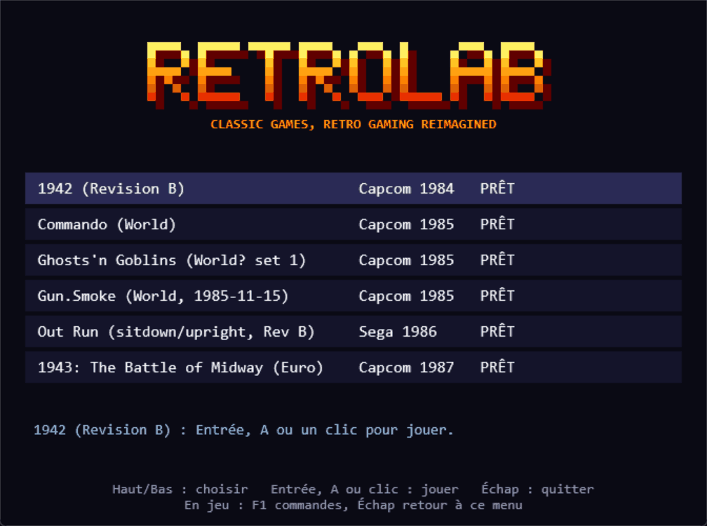

# RetroLab

*Classic Games, Retro Gaming Reimagined*

<details>
<summary><b>🇬🇧 English</b></summary>

Rewriting 1980s arcade games in modern Object Pascal, as code that both humans and AIs can read and reuse.

<p align="center"></p>

## Play

- Six arcade games: 1942, Commando, Gun.Smoke, 1943 and Ghosts'n Goblins by Capcom, OutRun by Sega.
- With an Xbox gamepad, or any XInput gamepad, plugged in even while the game runs. The keyboard works too.
- Better with two: 1943 is played by two at the same time, in co-op, one gamepad each. 1942, Commando, Gun.Smoke and Ghosts'n Goblins are played by two in turns, as on the cabinet.
- OutRun: left and right steer, button 1 accelerates, button 2 brakes, button 3 shifts gear. The gamepad vibrates when you leave the road; V switches it off.
- F1 shows the controls and lets you change them.

## The project

- This is a work in progress.
- Today, an arcade cabinet emulated in Delphi plays these six games.
- It is deterministic: the same inputs always give the same game. It is the reference for the rewrite.
- What comes next is in the [porting plan](PORTING_PLAN.en.md).

## ROMs: you provide them

No ROM is provided, and none may be added to this repository. Use your own ROM sets, in MAME format, and put them in a `roms/` folder at the root of the repository:

| Game | File | MAME set |
|---|---|---|
| 1942 | `roms/1942.zip` | 1942 (Revision B) |
| Commando | `roms/commando.zip` | Commando (World) |
| Gun.Smoke | `roms/gunsmoke.zip` | Gun.Smoke (World, 1985-11-15) |
| 1943 | `roms/1943.zip` | 1943: The Battle of Midway (Euro) |
| Ghosts'n Goblins | `roms/gng.zip` | Ghosts'n Goblins (World? set 1) |
| OutRun | `roms/outrun.zip` | Out Run (sitdown/upright, Rev B) |

Every file is checked by its CRC32. A wrong or missing file is reported by name.

## Build and run

1. Open `samples/Cabinet/Cabinet.dpr` in Delphi and compile for Win64. Every unit is listed in the `.dpr`: nothing to configure. Developed with Delphi 13.
2. Run `Cabinet.exe`: a menu lists the games, ready or with their ROM missing. `Cabinet.exe --set commando` starts a game directly.

## How the code is organised

The code follows the real machine: a cabinet, boards that plug into it, chips on the boards, and cartridges.

```
samples/Cabinet   the cabinet: window, sound, controls
src/cabinet       monitor, speaker, control panel, gamepads
src/core          the edge connector every board plugs into, ROM loading
src/boards        one unit per hardware board, named after its PCB number
src/chips         Z80, AY-3-8910, YM2203, Intel 8751: reusable by any board
src/romsets       the cartridges: which ROM files, for which board
```

- A board is named after its hardware (`Capcom84100`), never after a game.
- A game only exists as a cartridge in `src/romsets`.
- Adding a game on known hardware: one cartridge unit.
- Adding hardware: one board unit, reusing the chips.

The programs are in French or English (`--lang fr`, `--lang en`). A translation is one JSON file in `lang/`.

## License

MPL-2.0 ([LICENSE](LICENSE)). Third-party code and trademarks: [NOTICE.md](NOTICE.md). The project uses a few units of the GS-Core library, included in `third_party/gs-core`.

</details>

<details open>
<summary><b>🇫🇷 Français</b></summary>

Buts du projet :
- Réécrire et *comprendre* l'émulation de borne d'arcade et d'ordinateur
- écrite cela en Pascal objet moderne : représenté une abstraction des cartes electroniques des jeux et des circuits les cartes des années
- Les CPU et cartes des années 80 sont reconstruites puce par puce, avec un code que les humains comme les IA peuvent lire et réutiliser.
- De me permetre de jouer facilement à mes jeux retro préféré "out of the box", avec des manettes modernes et tout conrrectement configuré:)
- Peut être écrire des jeux hommages à ces titres qui ont construit le monde des jeux vidéo ?
  
<p align="center"></p>

## Jouer

- Jeux d'arcade émulés disponibles : 1942, Commando, Gun.Smoke, 1943 et Ghosts'n Goblins de Capcom, OutRun de Sega.
- À la manette Xbox, ou toute manette XInput, branchée même en cours de partie. Le clavier marche aussi.
- À deux, c'est mieux : 1943 se joue à deux en même temps, en coopération, une manette chacun. 1942, Commando, Gun.Smoke et Ghosts'n Goblins se jouent à deux chacun son tour, comme sur la borne.
- OutRun : gauche et droite pour tourner, bouton 1 pour accélérer, bouton 2 pour freiner, bouton 3 pour changer de vitesse. La manette vibre quand on sort de la route ; V coupe les vibrations.
- F1 affiche les commandes et permet de les changer.

## Le projet

- C'est un travail en cours.
- Aujourd'hui, une borne d'arcade émulée en Delphi fait tourner ces six jeux.
- Elle est déterministe : les mêmes entrées donnent toujours la même partie. Elle sert de référence pour la réécriture.
- La suite est dans le [plan de portage](PORTING_PLAN.md).

## Les ROMs : à fournir vous-même

Aucune ROM n'est fournie, et aucune ne doit être ajoutée à ce dépôt. Utilisez vos propres sets de ROM, au format MAME, dans un dossier `roms/` à la racine du dépôt :

| Jeu | Fichier | Set MAME |
|---|---|---|
| 1942 | `roms/1942.zip` | 1942 (Revision B) |
| Commando | `roms/commando.zip` | Commando (World) |
| Gun.Smoke | `roms/gunsmoke.zip` | Gun.Smoke (World, 1985-11-15) |
| 1943 | `roms/1943.zip` | 1943: The Battle of Midway (Euro) |
| Ghosts'n Goblins | `roms/gng.zip` | Ghosts'n Goblins (World? set 1) |
| OutRun | `roms/outrun.zip` | Out Run (sitdown/upright, Rev B) |

Chaque fichier est contrôlé par son CRC32. Un fichier faux ou absent est signalé par son nom.

## Compiler et lancer

1. Ouvrir `samples/Cabinet/Cabinet.dpr` dans Delphi et compiler en Win64. Toutes les unités sont déclarées dans le `.dpr` : rien à configurer. Développé avec Delphi 13.
2. Lancer `Cabinet.exe` : un menu affiche les jeux, prêts ou avec leur ROM manquante. `Cabinet.exe --set commando` lance un jeu directement.

## Organisation du code

Le code suit la vraie machine : une borne, des cartes qui s'y branchent, des puces sur les cartes, et des cartouches.

```
samples/Cabinet   la borne : fenêtre, son, commandes
src/cabinet       écran, haut-parleur, panneau de commandes, manettes
src/core          la prise où se branche chaque carte, chargement des ROM
src/boards        une unité par carte, nommée d'après son numéro de PCB
src/chips         Z80, AY-3-8910, YM2203, Intel 8751 : réutilisables par toute carte
src/romsets       les cartouches : quels fichiers ROM, pour quelle carte
```

- Une carte porte le nom de son matériel (`Capcom84100`), jamais celui d'un jeu.
- Un jeu n'existe que sous forme de cartouche, dans `src/romsets`.
- Ajouter un jeu sur un matériel connu : une unité de cartouche.
- Ajouter un matériel : une unité de carte, qui réutilise les puces.

Les programmes sont en français ou en anglais (`--lang fr`, `--lang en`). Une traduction est un fichier JSON dans `lang/`.

## Licence

MPL-2.0 ([LICENSE](LICENSE)). Code tiers et marques : [NOTICE.md](NOTICE.md). Le projet utilise quelques unités de la bibliothèque GS-Core, incluses dans `third_party/gs-core`.

</details>
